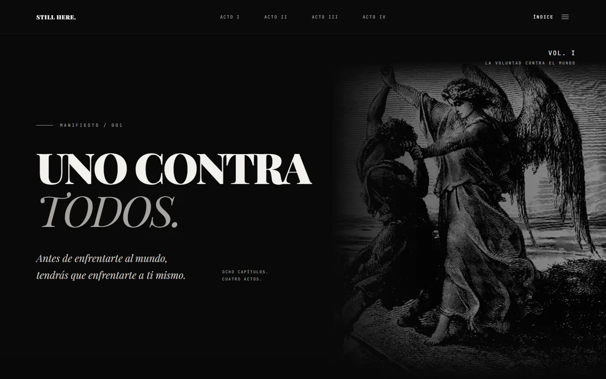
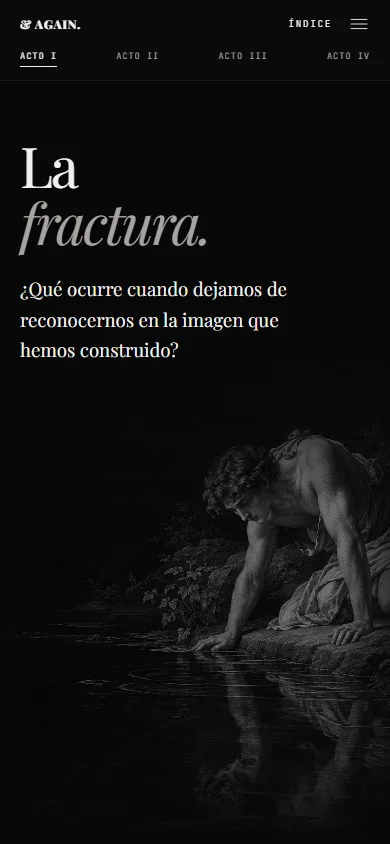

# STILL HERE. / & AGAIN.

**Una experiencia editorial interactiva sobre lo humano.**

Ocho relatos. Cuatro actos. Un recorrido por la identidad, el miedo, los límites y la libertad de elegir. El proyecto combina narrativa, grabados históricos y desarrollo frontend para convertir la lectura en una experiencia visual.



**[Autor: Chriss-DW](https://github.com/Chriss-DW)** · HTML · CSS · JavaScript · Diseño adaptable

## Concepto

La obra parte de una pregunta: ¿qué significa seguir aquí cuando cambian nuestras certezas? Los relatos antiguos funcionan como puntos de partida para reflexionar sobre decisiones y conflictos actuales. Cada capítulo distingue la historia original de su interpretación contemporánea.

La página inicial presenta las preguntas del recorrido. Las páginas interiores, identificadas como **& AGAIN.**, desarrollan los relatos sin imponer un orden de lectura ni bloquear el desplazamiento del visitante.

## Recorrido

| Acto | Tema | Relatos |
| --- | --- | --- |
| I · La fractura | Identidad y pérdida de certezas | Narciso / La Caída |
| II · La confrontación | Miedo y esfuerzo sin garantía de victoria | Goliat / Sísifo |
| III · La forja | Ambición, límites y cargas | Ícaro / Atlas |
| IV · La soberanía | Convicciones, consecuencias y transformación | Prometeo / Jacob |

## Experiencia e implementación

- **Cinco páginas independientes:** una introducción y cuatro actos con dos capítulos cada uno.
- **Dirección visual editorial:** tipografía clásica, paleta oscura y grabados integrados mediante máscaras CSS y encuadres por imagen.
- **Composición adaptable:** distribución en dos zonas en escritorio y lectura en una columna en móvil.
- **Navegación compartida:** índice modal, estado del acto actual y enlaces de continuidad entre capítulos.
- **Interacciones discretas:** progreso de lectura, círculo de inversión en la navegación y movimiento localizado en la portada.
- **Contenido accesible:** encabezados semánticos, texto alternativo, enlace para saltar al contenido, foco de teclado y preferencias de movimiento reducido.
- **Recursos locales:** imágenes y fuentes alojadas con el proyecto; sin servicios externos durante la lectura.

<details>
<summary>Ver una portada en móvil</summary>



</details>

## Tecnologías

| Tecnología | Uso |
| --- | --- |
| HTML5 | Estructura semántica, páginas y diálogos nativos |
| CSS | Sistema visual, Grid, Flexbox, máscaras y adaptación a pantallas |
| JavaScript | Navegación, foco, progreso y efectos de portada |
| Node.js | Servidor local para desarrollo y ejecución de pruebas |
| Playwright | Pruebas funcionales, navegación y capturas |

El sitio funciona sin framework ni compilación. Node.js y Playwright se utilizan como herramientas de desarrollo; no son necesarios para visitar la página publicada.

## Ejecutar localmente

Sitio estático en HTML, CSS y JavaScript, sin compilación ni dependencias de ejecución. Se puede abrir `index.html` directamente o utilizar un servidor local con Node.js:

```sh
npm start
```

Abrir [localhost:4173](http://127.0.0.1:4173). También se puede abrir `index.html` directamente. Para alojarlo, servir la raíz del proyecto conservando las rutas de sus carpetas.

## Estructura

```text
index.html             Inicio y acceso a los cuatro actos
actos/                 Cuatro páginas de lectura
css/
  fonts.css            Fuentes locales
  global.css           Paleta, tipografía y reglas compartidas
  navigation.css       Navegación e índice accesible
  home.css             Composición del inicio
  actos.css            Portadas y capítulos de los cuatro actos
js/
  home.js              Entrada y composición de la portada
  navigation.js        Índice, foco, anclas y efecto de navegación
  interactions.js      Progreso de lectura compartido
img/                   Ocho imágenes utilizadas por el sitio
fonts/                 Fuentes WOFF2 y sus licencias
docs/                  Fuentes narrativas, créditos y capturas del proyecto
scripts/serve.cjs      Servidor de desarrollo sin dependencias
tests/site.test.cjs    Verificación funcional y adaptable
```

## Verificar

Las pruebas requieren Node.js y Playwright únicamente durante el desarrollo:

```sh
npm install
npx playwright install chromium
npm test
```

Comprueban las cinco páginas a seis tamaños de pantalla, enlaces y anclas locales, carga de recursos, ausencia de desbordamientos, estructura de encabezados, índice modal, teclado, efecto circular, fuentes desplegables y progreso. También comprueban lectura sin JavaScript y con movimiento reducido. Las capturas y el informe se guardan en `test-results/`, excluido de Git.

Opcionalmente, `PLAYWRIGHT_CHANNEL=msedge` utiliza Microsoft Edge instalado. `TEST_OUTPUT_DIR` permite guardar el informe fuera del proyecto.

## Decisiones de diseño

La jerarquía tipográfica utiliza **Playfair Display** para títulos y voz literaria, **Inter** para lectura y **JetBrains Mono** para navegación y numeración. Las portadas comparten un sistema visual, con posiciones de imagen ajustadas a cada obra para mantener legible el texto.

El índice se implementa con `<dialog>` y gestión de foco. Las animaciones respetan `prefers-reduced-motion`; el contenido y los enlaces entre páginas permanecen disponibles sin JavaScript. Los cuatro actos comparten estructura, controles y pie de página.

El reto principal fue mantener una identidad consistente entre imágenes de formatos y tonos diferentes, sin perder el carácter de cada relato. La solución combina estilos compartidos con ajustes de encuadre específicos, en lugar de duplicar la implementación de cada página.

Las decisiones del proyecto se documentan en [DESIGN.md](DESIGN.md) y [PRODUCT.md](PRODUCT.md).

## Fuentes y créditos

Consultar [fuentes narrativas e imágenes](docs/FUENTES-Y-DECISIONES.md) y [licencias tipográficas](fonts/README.md). Algunas reproducciones heredadas todavía tienen atribución y procedencia pendientes de verificar; no se presentan como recursos con derechos verificados. Las notas correspondientes permanecen en cada capítulo.
